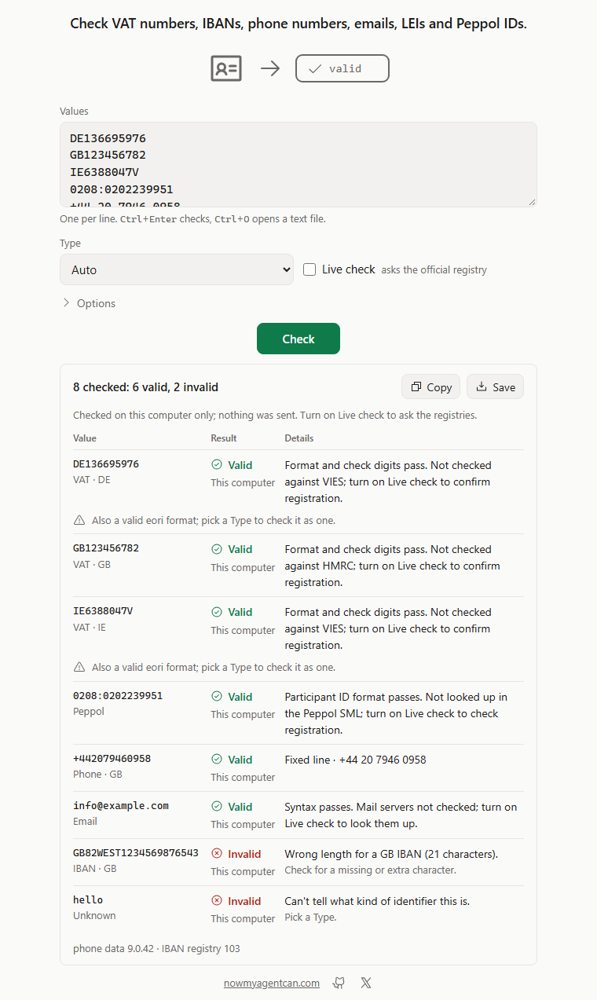

# validate-identifier

Check IBANs, VAT numbers, phone numbers, emails, LEIs, ABNs, Swiss UIDs, EORI numbers and Peppol IDs: offline by format and check digits, or live against the official registries. One small binary.



## Install

Windows (PowerShell, no admin; installs to `%LOCALAPPDATA%\Programs\validate-identifier` and adds it to your user PATH):

```powershell
irm https://github.com/nowmyagentcan/validate-identifier/releases/latest/download/install.ps1 | iex
```

macOS and Linux (installs to `~/.local/bin`):

```sh
curl -fsSL https://github.com/nowmyagentcan/validate-identifier/releases/latest/download/install.sh | sh
```

Both scripts check the archive's SHA-256 against `SHA256SUMS` before installing anything. Or download an archive yourself; each holds one `validate-identifier` binary that needs no runtime:

| System | Download |
|---|---|
| Windows x64 | [validate-identifier-v0.1.0-windows-x64.zip](https://github.com/nowmyagentcan/validate-identifier/releases/download/v0.1.0/validate-identifier-v0.1.0-windows-x64.zip) |
| macOS Apple silicon | [validate-identifier-v0.1.0-macos-arm64.tar.gz](https://github.com/nowmyagentcan/validate-identifier/releases/download/v0.1.0/validate-identifier-v0.1.0-macos-arm64.tar.gz) |
| macOS Intel | [validate-identifier-v0.1.0-macos-x64.tar.gz](https://github.com/nowmyagentcan/validate-identifier/releases/download/v0.1.0/validate-identifier-v0.1.0-macos-x64.tar.gz) |
| Linux x64 (static) | [validate-identifier-v0.1.0-linux-x64.tar.gz](https://github.com/nowmyagentcan/validate-identifier/releases/download/v0.1.0/validate-identifier-v0.1.0-linux-x64.tar.gz) |
| Linux arm64 (static) | [validate-identifier-v0.1.0-linux-arm64.tar.gz](https://github.com/nowmyagentcan/validate-identifier/releases/download/v0.1.0/validate-identifier-v0.1.0-linux-arm64.tar.gz) |

With Rust: `cargo install --git https://github.com/nowmyagentcan/validate-identifier --tag v0.1.0 --locked`.
To remove it, delete the binary (on Windows, the `validate-identifier` folder above).

## Use

```sh
validate-identifier check DE44500105175407324931                   # an IBAN, offline
validate-identifier check "+44 20 7946 0958" "07911 123456" -r GB  # phone numbers
validate-identifier check 5493001KJTIIGC8Y1R12 CHE-116.281.710     # the type is detected
validate-identifier check IE8256796U -t eori                       # or given
validate-identifier check IE6388047V CHE-116.281.710 --live        # ask VIES and the Swiss UID register
validate-identifier check BE0202239951 -t peppol --live            # on Peppol? which documents?
validate-identifier check -f customers.txt --live --json
```

```text
$ validate-identifier check DE44500105175407324931 "+44 20 7946 0958" DE136695976 info@bücher.de 0208:0202239951 GB82WEST1234569876543
✓ DE44500105175407324931  IBAN · DE   valid · DE44 5001 0517 5407 3249 31
✓ +442079460958           Phone · GB  valid · fixed line · +44 20 7946 0958
✓ DE136695976             VAT · DE    valid · Format and check digits pass. Not checked against VIES; add --live to confirm registration.
  ! Also a valid eori format; pass --type to check it as one.
✓ info@xn--bcher-kva.de   Email       valid · Syntax passes. Mail servers not checked; add --live to look them up.
✓ 0208:0202239951         Peppol      valid · Participant ID format passes. Not looked up in the Peppol SML; add --live to check registration.
✗ GB82WEST1234569876543   IBAN · GB   invalid · Wrong length for a GB IBAN (21 characters).
                                      Check for a missing or extra character.
6 checked: 5 valid, 1 invalid
```

- `-f FILE` reads one value per line (`-` for stdin; blank and `#` lines skipped). `-r GB` sets the region for phone numbers written without `+`; `-t` sets the type when detection would guess wrong.
- A value that fits two types (a German VAT number is also an EORI shape) carries a warning naming the other; pass `-t` to check it as that.
- Exit codes: 0 every value valid, 1 any invalid, inactive or not found, 2 usage, 3 a registry couldn't answer or isn't configured (the offline result is still given).

Run `validate-identifier` alone for interactive mode: type or paste values, and use `/live`, `/type vat`, `/region GB`, `/help` and `/quit`.

**The page:** `validate-identifier ui` opens a small page in your browser, served on `127.0.0.1` only. Paste one value per line, tick Live check if you want the registries asked, and press Check. Copy and Save give the table as text or `identifiers.csv`.

### Use with AI agents

Agents can run the CLI with `--json` (one JSON object on stdout with `results`, `summary` and `data`; usage errors go to stderr):

```sh
validate-identifier check DE136695976 --json
validate-identifier check BE0202239951 -t peppol --live --json
validate-identifier check -f ibans.txt --json
```

Or add the local MCP server (stdio, one tool `validate_identifiers` taking `values`, `type`, `live`, `region` and `requester_vat`):

| Agent | Setup |
|---|---|
| Claude Code | `claude mcp add validate-identifier -- validate-identifier mcp` (add `-e ABN_LOOKUP_GUID=...` for ABN checks) |
| Codex | `codex mcp add validate-identifier -- validate-identifier mcp` |
| Cursor (`~/.cursor/mcp.json`), Claude Desktop | `{"mcpServers":{"validate-identifier":{"command":"validate-identifier","args":["mcp"]}}}` |
| VS Code (`.vscode/mcp.json`) | `{"servers":{"validate-identifier":{"type":"stdio","command":"validate-identifier","args":["mcp"]}}}` |

The tool returns the CLI's `--json` object as `structuredContent` and as text, with at most 1,000 values per call (100 with `live`). Bad arguments (no values, too many, an unknown type or argument) return `isError: true` with one text block holding `{"error":{"code","message","hint"}}`; an invalid identifier is a normal result, so read each result's `status`. Credentials reach it through the client's `env` setting, never through tool arguments.

## Supported inputs and limits

- **IBAN:** the 104 countries of the SWIFT IBAN Registry release 103: country, length, account format and check digits, with bank and branch IDs.
- **VAT:** the EU 27 (`EL` or `GR` for Greece), Northern Ireland (`XI`), the UK and Switzerland (`CHE…MWST`): format and check digits; Czech, Latvian and Slovak numbers by format only.
- **Phone:** valid for its range, type (mobile, fixed line, ...), region, E.164 and national forms, from Google's libphonenumber metadata 9.0.42.
- **Email:** RFC 5322 and 6532 address syntax without comments or folding whitespace (UTF-8 local parts allowed), internationalised domains (UTS 46), length limits; quoted local parts and address literals pass with a warning.
- **LEI** (ISO 17442), **ABN** (Australia), **Swiss UID** (`CHE-…`), **EORI** (EU, XI, GB; format only offline) and **Peppol** participant IDs (`0208:0202239951`, or a VAT number, ABN, UID or LEI with `-t peppol`, Peppol code list 9.7).
- Limits: 256 bytes per value, 10,000 values and 4 MB per file; with `--live`, 1,000 values per run.
- It doesn't check whether a bank account exists, whether a phone number is in service, or whether a mailbox accepts mail.

## Live checks

Nothing leaves your computer unless you pass `--live`, tick Live check, or an agent sets `live`. Then each value goes straight from your computer to its official source, and to nobody else:

| Checks | Source and host | What it receives | Credentials |
|---|---|---|---|
| EU and XI VAT | VIES, `ec.europa.eu` | the VAT number, plus your `--requester` number if you pass one | none |
| UK VAT | HMRC, `api.service.hmrc.gov.uk` | your client ID and secret (once, for a token), then the VAT number and any `--requester` number | your own `HMRC_CLIENT_ID` and `HMRC_CLIENT_SECRET` |
| Swiss VAT and UID | UID register, `www.uid-wse.admin.ch` | the UID | none |
| ABN | ABN Lookup, `abr.business.gov.au` | the ABN and your GUID | your own `ABN_LOOKUP_GUID` |
| LEI | GLEIF, `api.gleif.org` | the LEI | none |
| EU and XI EORI; GB EORI | EOS, `ec.europa.eu`; HMRC, `api.service.hmrc.gov.uk` | the EORI number | none |
| Peppol | your DNS resolver and the Peppol SML; then the participant's own SMP over HTTPS | a hash of the participant ID; then the ID | none |
| Email | your DNS resolver | the domain only, never the part before @ | none |

- Without your own credentials, nothing goes to HMRC's VAT check or to ABN Lookup: the result is `not_configured`, with the offline answer. Beyond the table, requests carry only the User-Agent `validate-identifier/<version>`.
- Phone numbers and IBANs never leave the computer. Nothing is stored; the HMRC token lives in memory until the process ends. Proxies come from `HTTPS_PROXY` and `NO_PROXY`, and certificates from the system's trust store. The CLI's `--dns IP[:PORT]` picks the resolver for email and Peppol; the page and the MCP server use the system's.
- For a mirror or a test server, `VALIDATE_IDENTIFIER_VIES_URL`, `_EOS_URL`, `_HMRC_URL`, `_UID_URL`, `_ABN_URL` and `_GLEIF_URL` replace a registry's base address (https://, or http:// on 127.0.0.1, [::1] or localhost; no user name or password). The registry's own API path is appended and its own answer format expected, so a test server must imitate that API; `--debug` prints each request with secrets redacted.
- Requests are paced to each source's published limits (VIES one per second, the UID register 20 per minute, GLEIF 60 per minute). A source that fails twice is skipped for the rest of the run. An outage gives `unavailable` or `rate_limited`, never `invalid`.
- **HMRC:** register an application on the HMRC Developer Hub, subscribe it to "Check a UK VAT number" v2, and try it with sandbox credentials and `VALIDATE_IDENTIFIER_HMRC_URL=https://test-api.service.hmrc.gov.uk`. Production credentials need a registered organisation; HMRC reviews requests in about 10 working days.
- **ABN Lookup:** accept the ABN Lookup web services agreement on abr.business.gov.au to receive a free GUID by email.
- **Registry terms:** VIES is for checking business partners, one request per number, with no extraction or retransmission of its data. The Swiss UID register allows single-entity queries only; bulk access needs Federal Council approval. GLEIF data is CC0 and implies no endorsement by GLEIF. Answers from HMRC, ABN Lookup and the other registries imply no endorsement or accreditation by them.

## How it works

IBANs are checked with [iban_validation_rs](https://github.com/ericqu/iban_validation), built from the SWIFT IBAN Registry; phone numbers with [rlibphonenumber](https://github.com/vloldik/rlibphonenumber) and Google's [libphonenumber](https://github.com/google/libphonenumber) metadata; VAT check digits are ported from [valvat](https://github.com/yolk/valvat) (MIT); LEI, ABN, UID, EORI, email and Peppol rules are our own code.
Live checks use [ureq](https://github.com/algesten/ureq) with [rustls](https://github.com/rustls/rustls) and [hickory-dns](https://github.com/hickory-dns/hickory-dns); the MCP server uses [rmcp](https://github.com/modelcontextprotocol/rust-sdk).
Every answer names its data versions, and a monthly check opens an issue when the phone data, the IBAN engine or the Peppol code list has a newer release.

## First run on an unsigned build

Windows: if "Windows protected your PC" appears, choose More info, then Run anyway.
The install script doesn't trigger it; a zip extracted in Explorer may.

macOS: if it says the developer can't be verified, open System Settings, Privacy & Security, and choose Open Anyway.
The install script doesn't trigger it, because curl downloads carry no quarantine flag.

## Licence

Apache-2.0, see [LICENSE](LICENSE). Each release archive includes `THIRD-PARTY-LICENSES.txt` for the bundled dependencies and data (libphonenumber metadata, valvat, Phosphor Icons).

---

[nowmyagentcan.com](https://nowmyagentcan.com) · [x.com/chayp05](https://x.com/chayp05)
